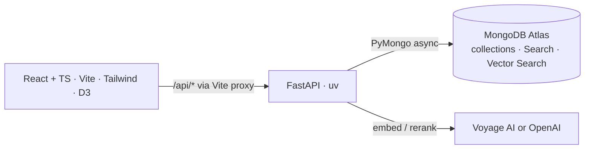

# test-demo-blank

A MongoDB Atlas demo built with the MongoDB Demo Kit. Synthetic data only.

<!-- Screenshot slot: record docs/demo.gif, then replace this comment with  -->

## What it demonstrates

<!-- features:start -->
- Setup page: connection test, deterministic seeding with embeddings, Search and Vector index builds
- **Transformation** page (works before seeding): an interactive, field-by-field view of how each DynamoDB item becomes a MongoDB document, with round-trip comparisons, the key-design → index map, and the simplification and flexibility benefits
- **Sample Queries** page: the 12 sample queries from [`Sample_Queries_Criteria.md`](design_resources/Sample_Queries_Criteria.md) (T1–T7 over the talent quads, A1–A5 over the RDF 1.2 items), each in one aggregation, compared with its ideal answer (✅/❌), with a "Run ×20" p50/p95 timer
- Multi-hop traversal across named graphs with one `$graphLookup` (T3), Atlas Search on labels (T6), nested reverse lookups on `facts` (A2) and RDF 1.2 triple terms (A3)
- Write demos: atomic quad replace in a transaction (with simulated rollback) and a timed named-graph reload
- Bonus semantic search (`$vectorSearch`) over the LIVE snapshot
<!-- features:end -->

Every query shows the exact aggregation pipeline it ran (**Query** button), with timings and optional `explain()`.

## Architecture



## Prerequisites

- [Node.js 22+](https://nodejs.org/)
- [uv](https://docs.astral.sh/uv/getting-started/installation/) (installs Python 3.12 for you)
- A MongoDB Atlas cluster running **MongoDB 9.0**, **M10 or larger** recommended, with your IP on the access list
- An embedding API key: a Voyage AI [model API key from Atlas](https://www.mongodb.com/docs/voyageai/management/api-keys/) or an OpenAI key

## Quick start

```bash
npm install
npm run dev
```

1. Open <http://127.0.0.1:5173> → **Setup**. Paste your connection string and API key, then **Save** and **Test Connections**.
2. Click **Seed Database**, then **Create Indexes** and wait until all indexes are ready.
3. Open the demo pages in the nav.

Settings are stored server-side in `api/config/settings.json` (gitignored, mode `0600`) and are never sent back to the browser unmasked. You can prefill them by copying `.env.example` to `.env`.

## Where's the MongoDB code?

<!-- codemap:start -->
| Feature | File | MongoDB docs |
|---|---|---|
| Setup: settings, connection test, seeding, index builds | [`api/app/core/setup.py`](api/app/core/setup.py) | [docs](https://www.mongodb.com/docs/atlas/atlas-search/manage-indexes/) |
| Sample-query pipelines (T1–T7, A1–A5, semantic) | [`api/app/modules/dynamo_graph/pipelines.py`](api/app/modules/dynamo_graph/pipelines.py) | [docs](https://www.mongodb.com/docs/manual/reference/operator/aggregation/graphLookup/) |
| Indexes: quad identity, forward/reverse lookups, nested multikey, Search, Vector | [`api/app/modules/dynamo_graph/indexes.py`](api/app/modules/dynamo_graph/indexes.py) | [docs](https://www.mongodb.com/docs/manual/core/indexes/index-types/index-multikey/) |
| Atomic quad replace and graph reload (transactions) | [`api/app/modules/dynamo_graph/writes.py`](api/app/modules/dynamo_graph/writes.py) | [docs](https://www.mongodb.com/docs/manual/core/transactions/) |
| Transformation page (DynamoDB item → MongoDB document) | [`web/src/modules/migration_story/`](web/src/modules/migration_story/) | [docs](https://www.mongodb.com/docs/manual/data-modeling/) |
| Workbook → fixtures converter | [`api/app/modules/dynamo_graph/convert.py`](api/app/modules/dynamo_graph/convert.py) | — |
<!-- codemap:end -->

## DynamoDB → MongoDB module

Design: [`design_resources/2026-11-17-dynamodb-to-mongodb-quads-design.md`](design_resources/2026-11-17-dynamodb-to-mongodb-quads-design.md).

- **Data**: the seed loads the gzipped fixtures in `api/app/modules/dynamo_graph/fixtures/`. They were built from the workbook HTML sheets in `design_resources/`; to rebuild them run `uv run --directory api python -m app.modules.dynamo_graph.convert`. The converter checks the row counts (15,651 / 818 / 4,974 / 239) and stops if they drift.
- **Scale-up**: start the API with `DYNAMO_GRAPH_SCALE=20 npm run dev`, then Seed Database and Create Indexes. That gives ~313K talent quads (cloned with suffixed ids such as `business:WADI~07`). Ideal-answer badges show only at scale 1, and the graph reload is disabled above scale 1. To record Phase 1 timings, use **Run ×20** on T3, T6 and A2.
- **Golden-answer test**: `MONGODB_URI_TEST=... npm run test:api -- -m atlas` seeds a throwaway database, checks all 12 answers and index usage, and exercises both write demos.

## Development

| Command | What it does |
|---|---|
| `npm run dev` | API on `127.0.0.1:8000` + Vite on `127.0.0.1:5173` |
| `npm test` | pytest + Vitest. `MONGODB_URI_TEST=... npm run test:api` also runs Atlas integration tests |
| `npm run lint` / `npm run typecheck` | ruff + ESLint / pyright + tsc |
| `npm run gen:types` | Regenerate `web/src/core/api-types.ts` from the FastAPI schema |
| `npm run build` | Production build of the web app |

To re-theme the demo for a prospect, edit the module's `seed.py` (vocabulary), `indexes.py` and UI labels, then re-seed.

## Build your own module

A module is a pair of folders that are discovered automatically: copy them in, restart `npm run dev`, and the module's API routes, seed data, indexes and nav entry appear.

```
api/app/modules/<name>/        Python package (use underscores, e.g. my_feature)
  __init__.py
  router.py      router = APIRouter(prefix="/api/<name>")      required
  seed.py        collections(), generate(rng), embed_fields      optional
  indexes.py     regular(), search(), vector(dims)               optional
  pipelines.py   pure functions that build aggregation pipelines
web/src/modules/<name>/
  index.tsx      export const route = { path, element, public? }; export const navItem = { label, order }
```

- **`seed.py`**: `generate(rng)` returns `{collection: [docs]}` using the seeded `random.Random` so data is deterministic. Fields listed in `embed_fields = {"collection": ["title", "description"]}` are embedded into `embedding` during **Seed Database**. Seeding drops and recreates only the collections from `collections()`.
- **`indexes.py`**: return dicts like `{"collection": "items", "name": "items_vector", "definition": {...}}`. `vector(dims)` receives the dimensions of the model the data was embedded with.
- **`router.py`**: add `Depends(require_ready)` (from `app.core.meta`) so endpoints return `409` until data is seeded and indexed, run pipelines with `run_pipeline()` and return `QueryResponse` (`app.core.query`) so the UI's Query Drawer can show the exact pipeline, timings and `explain()`.
- **Web**: set `route.public: true` for static pages that should stay available before Seed / Create Indexes. Call the API with `api.post()` from `web/src/core/api.ts` and type responses with `Schemas['...']` after running `npm run gen:types`. Reuse `QueryDrawer` from `web/src/core/QueryDrawer.tsx`.
- Put tests next to the code (`api/app/modules/<name>/tests/`, `*.test.tsx`); `npm test` picks them up.

Then **Seed Database** and **Create Indexes** on Setup, and the module's nav entry becomes active.

Notes: this is a local, single-user demo (no auth) bound to `127.0.0.1`. Seed and index jobs run in memory, so a code reload during seeding aborts the job: run Seed again. Tested on macOS and Linux; on Windows the settings file permissions are not enforced.

## License

[Apache-2.0](LICENSE)
